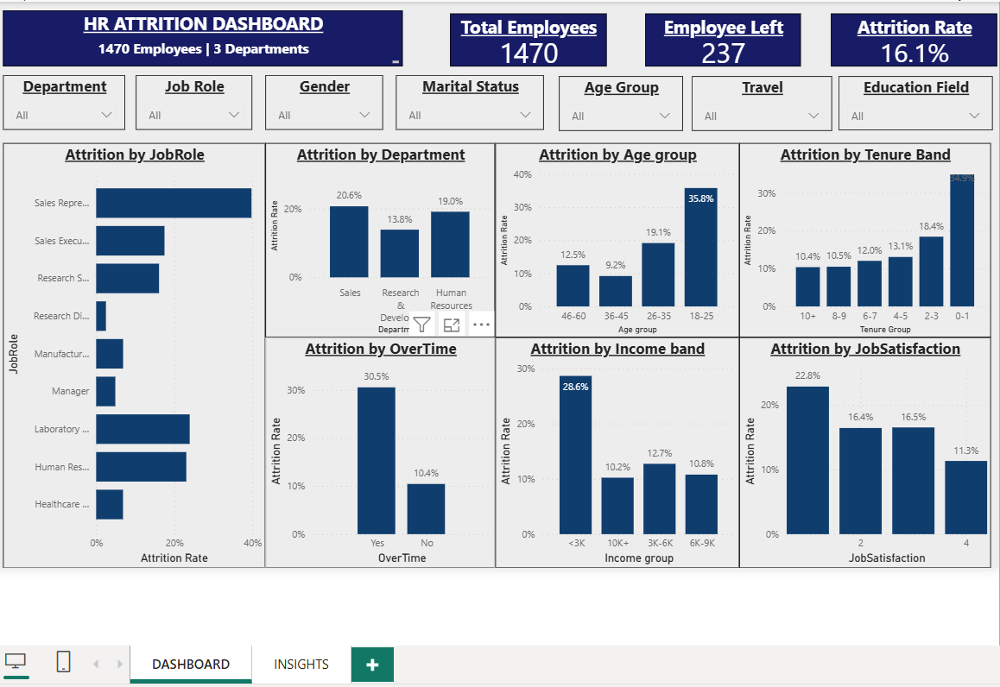

# 📉 HR Attrition Dashboard: Who Is Leaving, and Why?

> **237 of 1,470 employees left the company, a 16.1% attrition rate.**
> This Power BI project finds out *who* is leaving, *why* they might be leaving, and *what HR can do about it*.



## 📖 The story in 30 seconds

Imagine you are the HR head. The CEO asks: *"Why are we losing so many people?"*
The data gives a clear answer. Attrition is not random. It clusters around a few specific groups:

| 🔍 Finding | The numbers |
|---|---|
| **Overtime is the biggest driver** | 30.5% of overtime workers left, against 10.4% of those who don't work overtime |
| **The first year is the danger zone** | 34.9% of people with 0-1 years of tenure left |
| **Young employees leave the most** | 35.8% attrition in the 18-25 age group |
| **Sales Representatives are the hot spot** | 39.8% left, which is 1 in 2.5 |
| **Low pay hurts** | 28.6% attrition for those earning under 3K a month |

## 🎯 Business question
> *Which employees are most likely to leave, and which factors are linked to it, so that HR can act before talent walks out of the door?*

## 🗂️ Dataset

- **File:** `Attrition.csv`: 1,470 employees × 35 columns (age, department, job role, income, overtime, satisfaction scores and more)
- **Target column:** `Attrition` (Yes / No)
- **Data quality:** no missing values and no duplicate rows
- **Columns not used:** `EmployeeCount`, `Over18`, `StandardHours` (same value in every row), and `DailyRate`, `HourlyRate`, `MonthlyRate` (noisy, `MonthlyIncome` is used instead)

---

## 🛠️ Tools used

- **Power BI Desktop** for the report and visuals
- **DAX** for measures and calculated columns
- **Python (pandas)** to cross-check the numbers

---

## 🧱 How the dashboard is built

The dashboard is deliberately lean: **3 measures, 3 band columns, 3 cards, 7 slicers, 7 charts.**

### Measures

```DAX
Total Employees = DISTINCTCOUNT(HRA[EmployeeID])
Employee Left   = CALCULATE(COUNTROWS(HRA), HRA[Attrition] = "Yes")
Attrition Rate  = DIVIDE([Employee Left], [Total Employees])
```

### Calculated columns

`Age group`, `Tenure band` and `Income band` turn continuous numbers into readable groups. Each has a helper sort column so the bars appear in a logical order.

### Why *Attrition Rate* and not *Attrition Count*?

Groups have very different sizes. The 26-35 age group has the most leavers (116), but the 18-25 group is the real risk: **35.8% of them leave**, against 19.1% for 26-35. The rate compares groups fairly. Employee Left and Total Employees are shown in the tooltips.

### Layout

| Section | Content |
|---|---|
| **Top row** | Title and 3 cards: Total Employees, Employee Left, Attrition Rate |
| **Slicer row** | Department, Job Role, Gender, Marital Status, Age Group, Travel, Education Field |
| **Left column** | Attrition by Job Role |
| **Charts, "who leaves"** | Department, Age Group, Tenure Band |
| **Charts, "why they leave"** | OverTime, Income Band, Job Satisfaction |

---

## 📚 The findings, chapter by chapter

### Chapter 1: The big picture
237 of 1,470 employees left, an attrition rate of **16.1%**. That is roughly 1 in every 6 employees.

### Chapter 2: Who is leaving?
- **Young and new employees.** The 18-25 group has 35.8% attrition against 9.2% for ages 36-45. Employees in their first year show 34.9%, which falls steadily to about 10% for those with 10+ years. About **1 in 3 leavers** had one year of tenure or less.
- **Sales Representatives, Laboratory Technicians and HR staff.**
| Job role | Attrition rate |
|---|---|
| Sales Representative | **39.8%** |
| Laboratory Technician | 23.9% |
| Human Resources | 23.1% |
| Sales Executive | 17.5% |
| Research Scientist | 16.1% |
| Healthcare Representative | 6.9% |
| Manufacturing Director | 6.9% |
| Manager | 4.9% |
| Research Director | **2.5%** |
- **By department,** Sales (20.6%) and HR (19.0%) lose people faster than Research & Development (13.8%).
- **Single employees** leave more: 25.5% against 12.5% for married employees.

### Chapter 3: Why might they be leaving?
- **Overtime.** Overtime workers are only about 28% of employees, but they make up about **54% of everyone who left**.
- **Pay.** Employees earning under 3K a month show 28.6% attrition, against about 10% in the top income band. Leavers earned about 4.8K a month on average, against 6.8K for stayers.
- **Travel.** Frequent travellers show 24.9% attrition, against 8.0% for those who never travel.
- **Satisfaction.** Job Satisfaction level 1 shows 22.8% attrition against 11.3% at level 4. Work-Life Balance level 1 shows 31.2%.

### Chapter 4: The highest-risk profiles (extra analysis)
Risks add up when they overlap:
| Profile | Attrition rate | Employees in group |
|---|---|---|
| Overtime and age 18-25 | **64.1%** | 39 |
| Overtime and income under 3K | 56.1% | 114 |
| Overtime and single | 49.6% | 131 |
> ⚠️ The 18-25 and overtime group is small (39 people), so treat it as a signal to watch, not a firm conclusion.


## ✅ Recommendations
| # | Recommendation | Based on | How to measure success |
|---|---|---|---|
| 1 | **Review overtime workload.** Set overtime caps or add headcount in overtime-heavy teams, and flag people who work overtime for several months in a row | 30.5% vs 10.4% attrition | Fewer overtime workers; overtime group attrition below 20% |
| 2 | **Fix the first-year experience.** Run a structured onboarding with a buddy and 30/60/90-day check-ins | 34.9% first-year attrition | First-year attrition below 20% |
| 3 | **Run stay interviews in Sales.** Look at targets, pay structure and career paths for Sales Representatives | 39.8% attrition | Attrition in this role below 25% |
| 4 | **Benchmark entry-level pay.** Review pay for employees earning under 3K a month | 28.6% attrition in the lowest band | Under-3K band attrition below 20% |
| 5 | **Build a growth path for young talent.** Offer mentoring, learning plans and clear promotion steps for the 18-25 group | 35.8% attrition | 18-25 attrition below 25% |
| 6 | **Make travel fairer.** Rotate frequent travel and compensate it | 24.9% attrition for frequent travellers | Frequent-traveller attrition below 18% |
| 7 | **Listen early.** Run short pulse surveys on satisfaction and work-life balance, and follow up on low scores | 22.8% and 31.2% attrition at the lowest levels | Survey response rate; fewer level-1 scores |
| 8 | **Monitor monthly.** Review this dashboard every month and flag any segment above 25% attrition | Whole dashboard | Attrition rate trending below 16% |
*The targets above are illustrative starting points; set real ones with the business.*

## ⚠️ Limitations
- **Correlation is not causation.** The dashboard shows where attrition is high, not proof of why.
- **It is a snapshot.** There is no date column, so trends over time cannot be shown.
- **Some segments are small.** Sales Representatives (83) and HR (52) are small groups, so a few people can move the rate a lot.
- **No exit-interview data.** The real reasons for leaving are not in the dataset.

## 🚀 Next steps
- Add a predictive model (for example logistic regression) to score attrition risk per employee
- Add a time dimension to track attrition trends month by month
- Add a Work-Life Balance and Years Since Last Promotion view

## 📁 Repository structure
├── Attrition.csv          # dataset
├── HR-Attrition.pbix      # Power BI report
├── README.md
└── HR-Attrition/
    ├── AT1.png
    └── At2.png

## ▶️ How to use
1. Install [Power BI Desktop](https://powerbi.microsoft.com/desktop/) (free).
2. Download `HR-Attrition.pbix` and open it.
3. Use the slicers to filter by department, role, age group and more. Every chart updates together.

## 👤 Author
**Amruthesh P K**, HR professional moving into HR Analytics / People Analytics
🔗 LinkedIn: https://www.linkedin.com/in/amruthesh-p-k/

⭐ If you found this useful, please star the repository.
